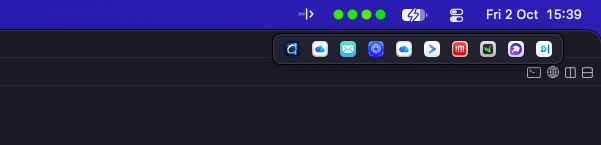

<div align="center">


# SmartHiddenBar

### Hide the menu bar clutter. Reach it in one click.

A small native **macOS 27** menu-bar app that hides every menu-bar item to the left of its icon,
shows them again in a tidy icon bar on demand, and lets you use a hidden item's menu **without unhiding anything**.

[](https://www.apple.com/macos/)
[](#requirements)
[](https://github.com/roypadina/SmartHiddenBar/releases/latest)
[](#install)
[](https://swift.org)
[](https://apps.roypadina.synology.me/apps/smarthiddenbar/)
[](LICENSE)
[](https://ko-fi.com/roypadina)
[](https://github.com/roypadina/SmartHiddenBar/stargazers)

<br>



<sub><i>The icon bar: everything currently off the menu bar, one click from its menu.</i></sub>

```bash
brew install --cask roypadina/tap/smarthiddenbar
```

</div>

---

## Features

- **One-click hiding.** Move the SmartHiddenBar icon (⌘-drag) and every item to its left hides. Click it (or press your own shortcut, set in Settings) to hide or show them.
- **Click mode per display.** Show → icon bar → hide (default on the built-in display), plain show / hide (default on external displays), or icon bar only.
- **Always hidden.** Pick apps that stay off the bar even while items are shown; reach them from the icon bar. Optionally, new menu bar apps go straight onto the list.
- **Icon bar.** Everything currently off the bar, as a row of icons under SmartHiddenBar's icon: ⌥-click, the click mode, or a keyboard shortcut (⌃⌥B by default, recordable in Settings). Hover an icon for its name; adjustable icon size.
- **Hover or click empty menu bar space** to show / hide (both optional).
- **Right-click menu.** Show Items / Hide Items, Disable/Enable SmartHiddenBar (disabled = nothing hidden, always-hidden included, as if quit), a **Menu Bar Apps** submenu listing every third-party menu bar app (icon + name), Settings…, About, Support and Quit SmartHiddenBar. Most have their own recordable shortcut.
- **Menu mirroring.** Pick a hidden item and use its menu from under SmartHiddenBar's icon, without unhiding it.
- **Real menu bar icons (optional).** With Screen Recording, the icon bar shows each item's actual menu-bar icon instead of the app icon.
- **Auto-rehide** after 5 / 10 / 30 / 60 s or as soon as the pointer leaves the menu bar, and **Open at Login**.
- **Welcome window.** First launch (and once after updating to 1.4.0) explains what SmartHiddenBar does, how to hide and reach items and why it needs Accessibility, and asks for it. Reopen it from Settings → About → Welcome Guide…
- **Tells you when it can't hide.** The menu bar icon turns into a warning triangle, with a tooltip saying what to do, when Accessibility isn't granted or hiding failed.
- **Notification Center keeps working:** clicking the clock lifts hiding until Notification Center closes.

## Install

```bash
brew install --cask roypadina/tap/smarthiddenbar
```

## Requirements

macOS 27 or later · Apple Silicon only (macOS 27 does not run on Intel Macs)

It will not work on earlier versions (see [Limitations](#limitations)).

### First launch

**Not notarized.** SmartHiddenBar is signed with a self-signed identity (no Apple Developer ID), so macOS may block the first launch. Open
**System Settings → Privacy & Security**, scroll down and click **Open Anyway** (right-click → Open
no longer works on macOS 15+), or clear quarantine once:

```bash
xattr -dr com.apple.quarantine "/Applications/SmartHiddenBar.app"
```

### Required setup

- **Run it from `/Applications`.** On macOS 27, MenuBarAgent resolves the allow-listed app through
  LaunchServices, which picks the `/Applications` copy; a copy anywhere else gets hidden along with the rest, so the app says so, offers Show in Finder and quits.
- **Accessibility (required).** It reads other apps' menu bar items through the Accessibility API. **Since 1.3.2 releases share one stable signature, so the grant survives updates; after updating from an older version re-grant it once**: toggle SmartHiddenBar off and on in System Settings → Privacy & Security → Accessibility, or reset and grant again:
  ```bash
  tccutil reset Accessibility com.roypadina.SmartHiddenBar
  ```
  The Welcome window asks for it on first launch; until it is granted the menu bar icon is a warning triangle and its menu starts with **Grant Accessibility…**.
- **Screen Recording (optional).** Only for "Real menu bar icons" in Settings. macOS asks about once a month whether to keep allowing it.

On first run, follow the Welcome window, then ⌘-drag the SmartHiddenBar icon to the right of the items you want hidden. Opening SmartHiddenBar again from Finder or Raycast shows Settings, so you can always get in, even when macOS has dropped its icon from the menu bar. While Settings, About or Welcome is open it also shows in the Dock and Cmd-Tab.

## Usage

| Action | Result |
|---|---|
| Click | The display's click mode (Settings → Click): show → icon bar → hide, show / hide, or icon bar only |
| Show/hide shortcut (off by default) | Hide / show everything left of the icon |
| ⌥-click, or the icon-bar shortcut (⌃⌥B default) | Icon bar with every item currently off the bar |
| Hover / click empty menu bar space (off by default) | Show items (hover: until the pointer leaves the bar) / show or hide |
| Click (or right-click) an icon in the icon bar | That item's menu, under SmartHiddenBar's icon |
| Hover an icon in the icon bar | Its app name |
| Right-click (or ⌃-click) | Show Items / Hide Items · Disable/Enable SmartHiddenBar · Menu Bar Apps ▸ (every third-party menu bar app; pick one to use its menu) · Settings… · About · Support · Quit SmartHiddenBar |

Settings (sections: General, Click, Shortcuts, Icon Bar, Permissions, Always Hidden, About): Open at Login, auto-rehide (after a delay or when the pointer leaves the bar), hover / empty-space click, click mode per display, always-hidden apps and what happens to new ones, five recordable shortcuts (show/hide items, icon bar, list apps, settings, quit; all off by default except the icon bar: click the shortcut, press a combo with ⌃, ⌥ or ⌘; Esc cancels, Delete or Off clears), app icons vs. real menu bar icons, icon size and names in the icon bar, and permission status.

## How it works

macOS 27's `MenuBarAgent` has a private "assessment mode" allow-list (`MenuBarClientCore`): while a
process holds it, the bar shows only the allowed apps plus system items. SmartHiddenBar allows
itself, the system items, and every app whose item sits to the right of its icon; apps left of the icon are denied. Hiding is
therefore **per app, not per item**. Nothing is moved or modified: quitting SmartHiddenBar
(or "Show Items") releases the allow-list and the full bar comes back. Item lists and menus are read, and
menu items pressed, through the Accessibility API (`AXExtrasMenuBar`). Mirroring copies the real menu, closes it, and replays your pick on the real one.

## Limitations

- **macOS 27 only.** It relies on a **private API** that Apple can change or remove in any update; if it is missing, SmartHiddenBar tells you and leaves everything visible.
- Hiding is **per app**: an app with several items hides or shows them together.
- **Apple's own items** (Control Center, Wi-Fi, clock, ...) can't be hidden.
- Only items **left of SmartHiddenBar's icon** are hidden (plus your always-hidden apps).
- macOS blocks Notification Center while hiding is active, so a click on the clock shows the hidden items until it closes.
- An app switched off in System Settings → Menu Bar → **Allow in the Menu Bar** never shows on the bar, with or without SmartHiddenBar; turn it on there.
- Mirrored menus are a snapshot: titles that change while the menu is open may be stale.

## Privacy

No network access, no analytics. It writes a small log to `~/Library/Logs/SmartHiddenBar.log`
(hide decisions and errors, no personal data) and preferences to the defaults domain `com.roypadina.SmartHiddenBar`.

## Build from source

```bash
git clone https://github.com/roypadina/SmartHiddenBar.git
cd SmartHiddenBar
./build.sh   # builds and installs /Applications/SmartHiddenBar.app (quit a running copy first)
```

`RELEASE=1 ./build.sh` makes a `build/SmartHiddenBar.zip` (signed with the maintainer identity when present, else ad-hoc) without installing. See [CONTRIBUTING.md](CONTRIBUTING.md).

## Uninstall

```bash
brew uninstall --zap --cask smarthiddenbar
```

Or quit it, drag `/Applications/SmartHiddenBar.app` to the Trash, and remove it from Login Items.

## Credits

The hiding approach and the private-API shim pattern come from [Hidden Bar](https://github.com/dwarvesf/hidden)
by Dwarves Foundation (MIT); see [LICENSE](LICENSE) for its notice.

## Feature requests and contributions

Have an idea for SmartHiddenBar? [Request a feature](https://github.com/roypadina/SmartHiddenBar/issues/new?template=feature_request.yml) and say what you're trying to do; that matters more than the exact feature. Found a bug? [Report it](https://github.com/roypadina/SmartHiddenBar/issues/new?template=bug_report.yml).

Code is welcome too: small, focused pull requests, and an issue first for anything bigger. See [CONTRIBUTING.md](CONTRIBUTING.md).

Tipped on [Ko-fi](https://ko-fi.com/roypadina)? Add your Ko-fi name to the request and it goes to the front of my queue. It's a thank-you, not a purchase: no promise on what ships or when.

## More Mac apps by Roy

Free, open-source Mac menu-bar apps and terminal tools, all on one site: **[apps.roypadina.synology.me](https://apps.roypadina.synology.me/)**.

- [LanGuard](https://apps.roypadina.synology.me/apps/languard/) — Wi-Fi off when you're wired. Back on when you're not.
- [Window Organizer](https://apps.roypadina.synology.me/apps/window-organizer/) — Clear the desk in one keystroke.
- [VaultBar](https://apps.roypadina.synology.me/apps/vaultbar/) — Your encrypted vaults, one click from the menu bar.
- [MeetAlert](https://apps.roypadina.synology.me/apps/meetalert/) — Meeting alerts you can't miss: a popup that stays, a phone push that escalates.

## Support

If SmartHiddenBar tidies your menu bar, you can support its development — it's optional and always appreciated.

[](https://ko-fi.com/roypadina)

A ⭐ on the repo helps just as much.

## License

[MIT](LICENSE) © Roy Padina
